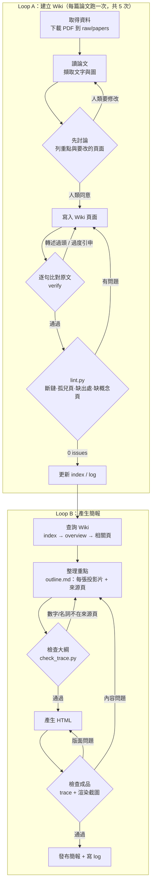

# LLM Agents Wiki：Loop / Graph 設計、執行紀錄與反思

## 1. 主題與簡介
- **主題**：LLM Agents（以大型語言模型為核心的自主代理）
- **做法**：依 Karpathy 的 LLM Wiki 模式，先讓 AI 訪談我、確認需求後才建檔（`AGENTS.md`），再一篇一篇 ingest 論文。
- **來源（5 篇）**：Wang et al. Survey、ReAct、Toolformer、Reflexion、Generative Agents
- **成果**：31 個 Wiki 頁面（5 論文頁、12 概念頁、9 實體頁、2 綜合頁，加上 overview、index、log），每句都標出處（§ / Table / Fig.）。
- **教學簡報**：15 張繁中 HTML 簡報「LLM Agents 是什麼？」，每張底部標出用到的 Wiki 頁面。

## 2. Loop / Graph 設計

**哪些步驟會重複？**
- Loop A 整個流程每篇論文跑一次（共 5 次），其中「寫入 ↔ 比對原文」和「寫入 ↔ lint」會在單篇內重複到通過為止。
- Loop B 中「整理重點 ↔ 檢查大綱」與「產生 HTML ↔ 檢查成品」會重複到全部通過。

**哪些地方需要檢查或重新生成？**
| 檢查點 | 檢查什麼 | 不通過時回到 |
|---|---|---|
| 先討論（人） | 重點是否正確、要改哪些頁 | 讀論文 |
| verify（逐句比對） | 轉述是否偏離、是否把自己的推論掛上原文出處 | 寫入 |
| lint.py | 斷鏈、孤兒頁、frontmatter、沒標出處的數字、缺少的概念頁 | 寫入 |
| check_trace.py（大綱） | 每個數字/名詞都出現在該投影片引用的 Wiki 頁 | 整理重點 |
| check_trace.py（成品）+ 渲染 | 生成時是否偷加內容；版面溢出、圖片、手機寬度、深色模式 | 整理重點 / 產生 HTML |

**為什麼這樣設計？**
- **先討論、後生成**：讓人類在最便宜的時候（還沒寫檔）就能修正方向。
- **每句都標出處**：讓之後所有檢查都能「機器比對」，而不是靠感覺。
- **檢查越早越便宜**：大綱只有幾行字，在大綱階段抓錯，比在 HTML 裡改便宜得多。
- **用工具檢查**：lint.py、check_trace.py 每次都能重跑，結果可以留紀錄。

## 3. 一次實際執行的檢查紀錄（摘自 wiki/log.md）
**Loop A（ingest）**
| 篇 | 檢查發現 | 處理 |
|---|---|---|
| #1 Survey | profiling 頁 2 句轉述與原文 §2.1.1 有落差 | 重新比對原文後改寫 |
| #2 ReAct | Survey 與原作者對 ReAct 的強調不同 | 標 `[!note]`，不標 conflict |
| #3 Toolformer | 我寫「Survey 把 Toolformer 歸類為用 LLM 生成資料微調」— Survey 沒這樣說 | 改成「Wiki interpretation」，移除出處 |
| #4 Reflexion | ReAct 的 71%（單次、PaLM）與 Reflexion 的 130/134（12 次、GPT-3）不能直接比 | 在 alfworld 頁加 `[!note]` |
| #5 Generative Agents | Survey 對 GA 的描述與原文逐點核對 | 一致，無需修改 |
| lint | 第 1 輪 13 個誤判（年份數字在連結裡）→ 修腳本；第 2 輪抓到「hallucination」出現 12 頁卻沒有概念頁 | 補建 hallucination 頁；第 3 輪 0 issues |

**Loop B（簡報）**
| 步驟 | 結果 | 處理 |
|---|---|---|
| 檢查大綱 第 1 輪 | 13/15 通過。S1「31 個頁面」不在 Wiki；S12「52%」vs Wiki「0.52」 | S1 刪除；S12 是檢查器誤判 → 修檢查器 |
| 人工看大綱 | S15「共同關鍵…」是自己的推論 | 標成（Wiki 綜合觀點） |
| 檢查成品 第 1 輪 | S15 失敗：生成時加了參考文獻，但來源沒列論文頁 | 回到大綱補來源 → 15/15 通過 |
| 渲染檢查 | 無溢出、圖片正常、手機無橫向捲動；但字和圖太小 | 回到產生 HTML 放大 → 通過 |

## 4. 反思
**哪一個節點最常出錯？**
「寫入／生成」節點。5 次 ingest 中所有真正的錯誤都發生在 AI 把原文寫成 Wiki 的時候：轉述過頭、把自己的推論掛上原文出處、把條件不同的數字放在一起比較。做簡報時同樣的事又發生了：生成 HTML 時順手加了參考文獻，卻沒有對應的來源。這和 Generative Agents 論文裡 Agent 會「加油添醋」記憶的現象是同一類問題。
其次是「檢查節點本身」：lint 第一輪 13 個全是誤判，trace 檢查也漏判過一次（52% vs 0.52）。檢查工具也需要被檢查。

**發現問題後，把檢查往前移到哪一步？**
- Ingest：從「整篇寫完最後才自我檢查」改成「**每寫完一句就回原文比對**」，並在寫之前加上「先和人類討論重點」。
- 簡報：從「做完 HTML 才檢查」改成「**大綱階段就跑 trace 檢查**」，確保每個數字、名詞都能在引用的 Wiki 頁找到，生成步驟只准排版、不准加新事實。

**有沒有因此修改 workflow？為什麼？**
有，`AGENTS.md` 從 v1 改為 v2（記錄在 log.md 的 `schema` 條目）：
1. 新增「Wiki interpretation」標記規則：自己的推論不能掛原文出處。
2. 新增跨論文比較數字的規則：條件不同要加 `[!note]`。
3. Ingest 第 8 步改成「寫完立刻逐句比對原文」，第 9 步加上跑 `lint.py`。
4. 把產生簡報寫成明確的 loop：大綱前後各一次 trace 檢查，失敗要回到指定步驟。

原因是：錯誤幾乎都來自生成時的「語意漂移」，越晚發現越難改；而 Reflexion 論文的消融實驗也顯示，沒有可靠的檢查，反省反而讓結果更差（60% → 52%）。所以我把「可靠、可重跑的檢查」放在每次生成之後的第一步。
